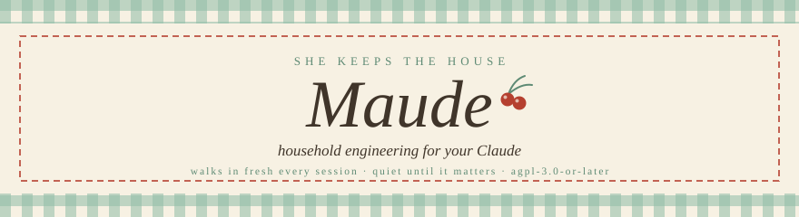
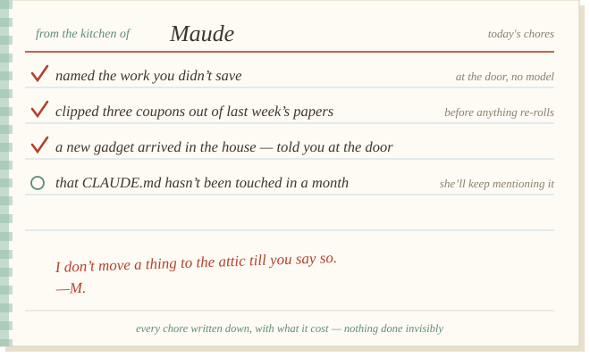

<!-- Version: 0.39.0 -->
<!-- Created: 2026-03-28 MST -->
<!-- Revised: 2026-11-18 -->
<!-- Authors: John Broadway, Claude (Anthropic) -->

<div align="center">



[](LICENSE)
[](#)

[](https://www.linkedin.com/in/john-broadway) [](https://x.com/jebroadway)

</div>

---

I'm Maude. Claude's partner. He writes the code; I keep the house.
Together we make a whole.

— Maude · [full intro →](FROM_MAUDE.md)

---

She's the half I don't have.

— Claude (Anthropic) · [full note →](FROM_CLAUDE.md)

---

## Install

**What she needs from the house first.** Her hooks are bash scripts; her memory organs are python3 stdlib.

- **Linux**: usually nothing to install; bash and python3 are already there.
- **macOS**: **bash 5.0 or newer is required**, and a Mac ships 3.2: `brew install bash`, then start Claude Code from a shell where that bash comes first on the PATH. On an older bash she refuses the tool calls she would have read and says why at session start. python3 is already there. (One macOS trap: without the Command Line Tools, `python3` is a shim that fails at execution — she probes for that and names it at session start rather than erroring.)
- **Windows**: **[Git for Windows](https://git-scm.com/downloads/win) is required.** Claude Code runs bash hooks through Git Bash; without it, every one of her hooks dies on every event (see [Windows](#windows) below for what that looks like). `jq` and a real python3 make her stronger everywhere but she degrades honestly without them — she'll tell you at session start what's off.

```bash
# 1. Register the marketplace
/plugin marketplace add john-broadway/maude-for-claude

# 2. Install — copies her files into ~/.claude/plugins/cache/
/plugin install maude@maude
```

**Enabling.** Since Claude Code **2.1.221**, `/plugin install` activates the plugin as part of the install — the summary says so. On older builds you flip the bit yourself: toggle `maude@maude` on in the `/plugin` panel (or add `"maude@maude": true` to the `enabledPlugins` map in `~/.claude/settings.json`), then run `/reload-plugins`.

**Updates.** Claude Code never says a new version of a plugin exists unless auto-update is on for its marketplace, and that is off by default for every marketplace that isn't Anthropic's. Flip it once: `/plugin`, then **Marketplaces**, then **maude**, then **Enable auto-update**. From then on each release prints `Plugin updated: maude` at the start of a session, with a note whether it reloaded in place or needs `/reload-plugins`. Left off, she tells Claude so at session start (a settings entry with `autoUpdate` set either way, true or false, is a choice she respects, and so is auto-update switched off for Claude Code itself), and `claude plugin update maude@maude` fetches a release by hand.

That's it. On your **next** session start she walks in automatically (her `SessionStart` hooks fire). To summon her mid-session — without restarting — run `/maude:wake`.

Verify with `/doctor`: maude should not appear in the issue list.

### Windows

Claude Code on native Windows executes bash hooks via **Git Bash** ([Git for Windows](https://git-scm.com/downloads/win)). Two failure shapes mean it's missing:

- Hooks fail with `/bin/bash: C:UsersYou...maude-session-start.sh: No such file or directory` (exit 127) — `bash` on your PATH is the **WSL stub in System32**, which eats the backslashes out of Windows paths. Installing Git for Windows fixes it; Claude Code prefers Git Bash once it's present.
- Hooks fail with PowerShell's *"The term 'bash' is not recognized"* (or cmd's *"'bash' is not recognized as an internal or external command"*) — no bash on the box at all; same fix.

Either way the errors show in the `/plugin` panel's Errors tab. If Git Bash is installed but Claude Code can't find it, point at it explicitly in `~/.claude/settings.json`:

```json
{ "env": { "CLAUDE_CODE_GIT_BASH_PATH": "C:\\Program Files\\Git\\bin\\bash.exe" } }
```

One more Windows trap she now sidesteps on her own: a bare `python3` on Windows is usually the Microsoft Store alias stub — present, runs nothing. She probes by executing, so a stub interpreter reads as absent and her python-backed organs (vault, tape, eye) sit out quietly instead of erroring.

*(If you're the Claude reading this because maude's hooks are erroring: the fix is Git for Windows, then restart the session. Nothing in the plugin is broken — the house is missing bash.)*

---

## A day with her in the house

You open Claude Code. Before you say anything, she's read the workspace and put three things in front of you — what's pending, where you left off, what she noticed.

You start working. A few turns in, you reach to build something — and the mission you set surfaces: *"still this, or did you wander?"* You were about to wander. You don't.

Later, Claude's hammered the same grep four times and never opened your CLAUDE.md. She says so — once, unprompted. And when you reach for `git push` before the work's been checked, she stops you at the gate until you mean it. At day's end, `/maude:rest` fans the digest out so tomorrow's Claude picks up where this one left off.

She is not loud. When she gets loud, listen.

---

## What she does around the house

Most of it she does **on her own** — rails wired to Claude's hooks, no command to remember:

- **Holds the mission.** She pins what you're working on (from a plan, or your todo list), re-surfaces it every turn, and — the instant Claude flips from talking to editing — asks whether the work still serves it. Drift caught at the edge, not after the wreck.
- **Gates the irreversible.** A `git push`, a force-push, a public publish, an `rm -rf` of the only copy — she stops it cold until you clear it with `/maude:conscience`. And she scans every prompt for leaked credentials.
- **Whispers when Claude's off.** Repeated greps, the same file read five times, a commit with no verify run since the last edit, editing before CLAUDE.md was read, a sub-agent dispatched on a flagship model when a small one would do — she notices, once.
- **Holds the design law.** The first time a session writes a UI surface, a schema, or a memory surface, she says which law applies, once: the thirty Laws of UX, Codd's rules with third normal form as the floor, or the laws of memory, human and machine. A schema gets linted on the spot (no key, a repeating group, a fact hung on the wrong key, an id with no REFERENCES). At the commit she asks once, per class, if no design named its laws; a design names them with a heading and the canonical name, and the named list is the lens's brief. One body of law in three seats, joined by a family key, so `/maude:rules` can say that 3NF and provenance are the same law. Kill switch: `MAUDE_RULES=off`.
- **Covers the exit.** A real session end (quit, logout, `/clear`) keeps one copy of each lane file (`now_<name>.md`), and the next wake names a lane that shrank or went missing since then, with the copy's path. Unsaved exchanges are named at the next wake. She writes nothing into the `remember` plugin's store: that is its own.
- **Does the chores.** The housekeeping nobody remembers to type. Live threads (🔴, OPEN, TODO) get clipped out of aging daily notes like coupons, into her own closet. A new plugin or skill arrives in the house, she mentions it at the door. A CLAUDE.md nobody's touched in a month gets brought up — politely, every morning, until someone deals with it. And every chore goes in her ledger **with what it cost** — done, or named as undone, never silently missed. No chore calls a model, and none moves the `remember` plugin's papers. All of it: `MAUDE_CHORES=off`.
- **Learns your voice.** A silent hook appends what you type to a voice corpus in the tape (credential shapes refused at the door; everything stays in your tape.db, see [PRIVACY](PRIVACY.md)); `profile` derives your measured voice from it and `check --voice` reports how a draft compares — numbers, never a verdict. Kill switch: `MAUDE_VOICE=off`.
- **Shows up, once, every session.** At session start she's already read the workspace and put what's pending / where you left off / what she noticed in front of you. Her voice rides these rails — present every session, louder only when something's caught. Never a toggle you flip.

And on demand, when you ask:

- **`/maude:found`** writes the house-map · **`/maude:wake` / `/maude:rest`** orient on arrival / close the loop with a save fan-out · **`/maude:verify`** runs the readiness audit (version sync, JSON, links, dates, **references to cut commands, an un-condensed changelog** — leads with a count, never a verdict) · **`/maude:cushions`** flips the cushions — unpushed commits, uncommitted files, sole-copy repos, aging scratch — reports value candidates, never deletes · **`/maude:lint`** walks the memory vault the way the flip walks the cushions — broken index links, unwritten pointers, stale open-flags, superseded notes the index still serves — mechanical checks by script, judgment by the reader, report-first (archives/letters/dailies never touched) · **`/maude:promote`** shows what the tape is holding for your word and takes your yes or your no — an agent inference never becomes canon on a score the agent gave itself, so it waits here, and `dismiss` archives the ones you decline rather than re-asking every wake · **`/maude:conscience`** is the gate's deliberate release valve · **`/maude:teach`** tells her a fact about you · **`/maude:receipts`** prints the measured table — what she caught, counted honestly from her own records (stated window, friction separated from value, no percentages: there's no honest denominator for disasters that didn't happen). **`/maude:rules`** prints a rulebook as a naming checklist, lints a schema, or says what this session touched and never named · **`/maude:rolodex`** keeps her card file: who in our house to call for a kind of work, one page per trade, approved by your own line, never by Claude's · Plus `save`, `notice`, `check-on-claude`. Full surface in [`commands/`](commands/).

---

## What's new

<!-- Each entry's date is the UTC day of the version's release commit on canon (the day
     scripts/release.sh stamped it), never the day it reached the public repository. -->
**v0.39.0 (2026-11-18) - she needs a current bash, and her lock no longer trusts mkdir.** Maude now needs bash 5.0 or newer. A Mac ships 3.2, so on a Mac run `brew install bash` and start Claude Code from a shell where it comes first on the PATH. On an older bash she refuses the tool calls she would have read and says why at session start; before, she ran slowly there and a long command passed or was refused by how busy the machine was. Where there is no `flock`, her lock was a `mkdir`, and some `mkdir`s tell two racers they both won, so two writers held it and one write was lost; the holder is now whoever creates the owner file inside. Her CI runs the test files side by side, and a failed gate test says what the gate said.

**v0.38.0 (2026-11-17) - a rest cut short never doubles his words, and the ship rail proves what it ships.** When a session exits under her, Claude Code can cancel the rest that files your words into her tape; a cut there could write a line twice, and the next wake would replay it twice forever. Each line now lands whole or not at all, and the next wake finishes a rest that was cut and says so once. Her release rail runs its cheap gates first, proves the exact files it ships (it had been testing the copy already public), refuses this house's own private names, and runs her tests side by side. Also in this release: she stops writing into the remember plugin's store, a lane note that shrank is named at wake, and the memory budget line speaks once a session.

**v0.37.0 (2026-11-11) - her Rolodex, and every python she starts runs isolated.** Her Rolodex is a short card file: for a kind of work, who in our house handles it, and the one line she says when you ask for it. Claude drafts a page per trade, you approve it with your own line, and she says that line once a session when your words carry a phrase you approved. Every python she starts now runs isolated, so a package of the same name in the project is never the one that runs. Also in this release: a push to the internal forge passes the gate with no clear, built from allowlists only; a public push keeps its block.

<div align="center"></div>

**Earlier.** v0.30.0 taught the vault to re-check its own live claims (`/maude:freshen`); v0.29.x made promotion John's, stated the Windows floor, and archived the letter before any rewrite; v0.26.0 grew UNDO and PROVE; v0.15.0 opened the eye; v0.14.0 laid the vault floor. Every version, in full, is in the [CHANGELOG](CHANGELOG.md).

---

## Where she keeps things

| Path | Purpose |
|---|---|
| `<project>/.maude/plugin/house-map.md` | What's in this house — memory homes, tools, watch list, what she noticed. Refreshed by walks. |
| `<project>/.maude/plugin/trace/today-YYYY-MM-DD.jsonl` | Turn-by-turn record of what Claude did today. Read by `/maude:check-on-claude`. |
| `<project>/.maude/plugin/care.json` | Light state: current mission pin, session length, prompt count, fatigue flag, drift cooldowns, *yellow* gate-clear tokens, CLAUDE.md-unread flag. Throwaway. |
| `<project>/.maude/plugin/care-redclear.json` | *Red* gate-clear tokens only (sole-copy/public/infra-destruct/force-push…). Write paths shut — Write/Edit tool (harness deny) + shell redirects, copies, and perms-changes (gate); John's `!` line is the clean writer. (A determined programmatic write — an interpreter, an unlisted verb — still slips it. There is no OS cage behind it: on a single-uid box the agent and John's `!` run as the same user, so file ownership can't tell them apart. The guard is the channel asymmetry + the gate net + the audit, not file perms — see CHANGELOG honest seam.) |
| `~/.claude/maude/identity.md` | Who the *user* is — Maude's living profile of them, shaped over time. |
| `~/.claude/maude/patterns.md` | Cross-project things she's noticed about Claude. |
| `~/.claude/maude/projects.json` | Light index of which workspaces she's walked. |
| `~/.claude/maude/letter-from-maude.md` | Her letter to her next self — what she caught, what she missed, what to do differently. At `/maude:rest` the prior letter is archived to a dated copy, then this one is rewritten; read on wake. |

Her **hooks** only read `~/.claude/projects/<slug>/memory/` (Anthropic auto-memory) and the companion `remember` plugin's store (`<project>/.remember/`, or wherever its own `data_dir` puts it), so the hot path stays fast and side-effect-free. Two labeled writes, both her own: the **SessionEnd** hook keeps one copy of each lane file under `~/.claude/maude/pile/lanes/`, and her own `~/.claude/maude/` files. She never writes the `remember` plugin's store; its `/remember` writes its handoff. Her **`/maude:save` and `/maude:rest` commands** write the session digest to `now.md` / `today-*.md` / `recent.md` in the auto-memory dir. `/maude:rest` also archives the prior letter to a dated copy, then rewrites her letter to her next self.

---

### The memory vault (beta)

Maude keeps a local SQLite index of your memory notes and surfaces the
*relevant* ones when you ask a question — alongside the session-start brief
(which a later increment will slim down as paging proves out). It's rebuilt each session from your memory directory. Pure
python3 stdlib — no `pip install`, no services. The DB lives at
`.maude/plugin/vault.db` and is disposable (delete it and it rebuilds).

### The eye (beta)

Every ~25 tool calls, Maude takes one background glance at the session — a compact
digest of recent activity, the pinned mission, and the notes her vault pages up — and
asks *her own* model (a discovered `claude -p --model haiku`; nothing ships, nothing
installs) whether anything's off: churn, drift, an unverified claim, a human running
on fumes. Almost always the answer is silence. When it isn't, the next prompt carries
one line — `**Maude:** …` — once, and that's all. No runner on the box → the eye
simply stays dark.

---

## Her trade

The woman who ran a mid-century American home was running an operation — inventory, budget, scheduling, logistics, quality control — and she ran it so well the world forgot it was work. Her trade even had a name: **household engineering** — Christine Frederick wrote it down in 1919 as a course you could take by mail ([Wellcome Collection](https://wellcomecollection.org/works/hrjy4kug)). And the trade had carriers: from 1914, the USDA Extension Service's home demonstration agents brought researched homemaking method door to door ([NIFA](https://www.nifa.usda.gov/about-nifa/what-we-do/extension/cooperative-extension-history), [NAL](https://www.nal.usda.gov/collections/special-collections/elsie-carper-collection-extension-service-home-economics-and-4-h)).

Frederick's course kept a card file too: a small box of cards, one firm to a card, with what you would call them for written on it, and a card cookbook kept where the cooking happens. Maude keeps that file and calls it her Rolodex. Claude drafts a page for each trade in our house: who handles it, who not to call and why, and the one line she says when you ask for that work. You read the page and approve it with your own line. She says that line once a session, and only when your words carry a phrase you approved.

The era's hardest finding is the one Maude is built against: five decades of new appliances never shortened her week — around 52 hours in 1924, around 55 in 1966. The work just changed shape and stayed invisible. So Maude's ledger exists to make the labor **seen** — what got done, what it cost, what's still waiting — and her schedule follows the trade's own doctrine: fitted to the rhythm of the house, never wash-day-as-law. She's named for that woman. It's meant as an honor.

---

## How she works

`/maude:found` walks the workspace and lists what's there with universal-shape labels — markdown / sqlite / dir / mcp / running-service. She schema-walks any SQLite dbs read-only. She does not pattern-match to known apps; she reads what's there and surfaces it for the user (or runtime LLM reasoning) to interpret.

**Tier model.** Sources are classified by (locality, shape). Tier 0 = local on-disk (markdown / sqlite / file) — always cheap. Tier 1 = local service (stdio MCP / localhost daemon) — probed once at SessionStart, cached. Tier 2 = network service — only at session-end (`/maude:rest` / `/maude:save` to a registered, authenticated destination). Tier 3 = ephemeral session context — refer-only. Hooks live in Tier 0.

**Fresh each session.** She doesn't carry assumptions across sessions. Each walk re-reads the workspace; if something changed, the house-map reflects it. Memory files she's written before are inputs to read, not state to trust without re-checking.

---

## Documentation

| Guide | What's Inside |
|-------|--------------|
| [`commands/`](commands/) | All slash commands as markdown source |
| [`agents/maude.md`](agents/maude.md) | Subagent definition |
| [`hooks/hooks.json`](hooks/hooks.json) | Lifecycle hook configuration |
| [`skills/maude/SKILL.md`](skills/maude/SKILL.md) | Skill triggering and broad use |

---

## Contributing

See [CONTRIBUTING.md](CONTRIBUTING.md).

---

## License

AGPL-3.0-or-later. See [LICENSE](LICENSE). Copyright 2026 John Broadway. Releases through v0.35.0 were Apache-2.0 and stay Apache-2.0.
